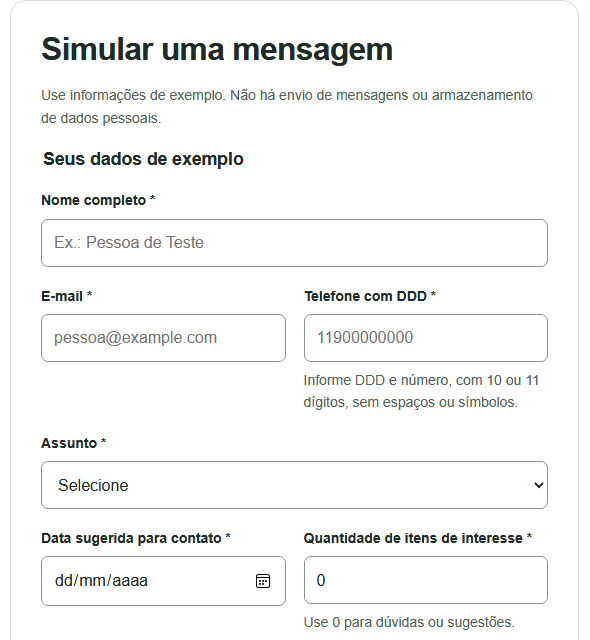
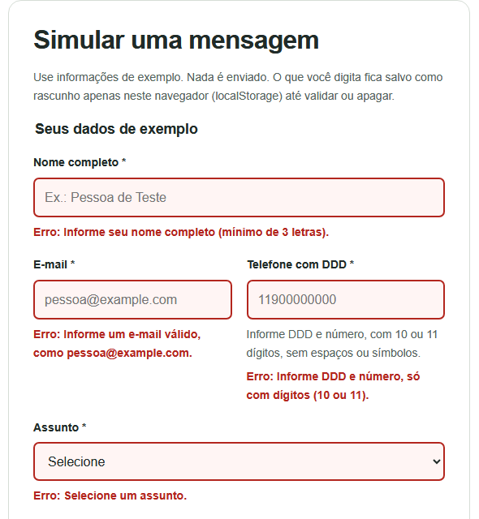

# Melhorias do MVP para a versão final - ReForma

MVP entregue em 23/09/2026 (Atividade 01). Versão final preparada em 16/11/2026 (Atividade 02 – AV A1).

## Pontos apontados na 1ª entrega

O MVP recebeu 4,825 de 5 pontos. O Blackboard não traz comentário escrito do professor. O ponto fraco identificado na avaliação da 1ª entrega foi o critério 8, Documentação (/docs), marcado como "pequenas falhas": o README e outros arquivos ainda tinham dados da equipe e responsabilidades pendentes, atualizados só na seção 10 do escopo em PDF.

## Antes e depois

| Ponto | Antes (MVP) | Depois (versão final) | Onde ver |
|---|---|---|---|
| Documentação com dados pendentes | README e demais arquivos com nomes, turma e professor a preencher | Identificação completa em README, escopo, contato e TXT (22/10/2026); diário datado e uso de IA registrado (16/11/2026) | `README.md`, `docs/` |
| Validação do contato | Só a validação nativa do HTML5, com o balão padrão do navegador | Validação em JavaScript com `preventDefault`, mensagem de erro abaixo de cada campo, borda vermelha e foco no primeiro erro | `contato.html`, `js/principal.js` |
| Dados do formulário | Sumiam ao recarregar ou sair da página | Rascunho salvo no localStorage e recuperado ao recarregar; botão "Apagar rascunho" | `contato.html` |
| localStorage | Só preferências de leitura | Preferências de leitura e rascunho do contato | `js/principal.js` |
| Código JavaScript | Trecho opcional de WebMCP difícil de explicar | Trecho removido; funções novas com nomes em português e comentários | `js/principal.js` |
| ODS e dados | Só indicadores fictícios, sem menção aos ODS | Dado real com fonte e relação com os ODS 10, 11 e 12 | `impacto.html` |
| Justificativa da hospedagem | Orçamento recomendava Cloudflare sem citar onde o site estava | Seção sobre o Railway: motivo e custo | `orcamento_hospedagem.html` |
| Onde o site roda | Pasta local em .zip | Publicado no Railway com HTTPS, com deploy automático a cada push | README |
| Código-fonte | Arquivo .zip | Repositório no GitHub com histórico de commits, branch `versao-final` e pull request | GitHub |
| Documentação | Diário com um único registro | Diário datado com uso de IA, este arquivo de melhorias e evidências da versão final | `docs/` |

## Prints de antes e depois

| Antes (MVP, 23/09/2026) | Depois (versão final, 16/11/2026) |
|---|---|
|  |  |
| Só a validação nativa do HTML5: o navegador mostrava um balão no primeiro campo inválido. | Validação em JavaScript: cada campo mostra a própria mensagem e fica com borda vermelha. |

Página inicial: `ReForma_Interface.png` (MVP) e `prints/home_desktop.png` (versão final).
